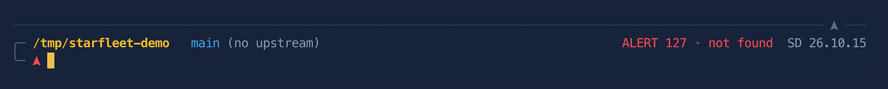
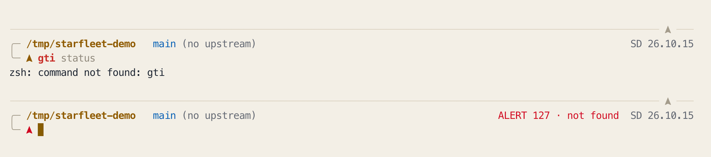

# dotfiles

Zsh configuration. Prompt: Powerlevel10k, two-line framed, in a Star Trek
"Starfleet" theme that follows macOS light/dark — see [Theme](#theme-starfleet).

## Layout

| Path | What it does |
|---|---|
| `.zshrc` | Thin loader. Oh My Zsh + plugins, then sources the modules below. |
| `zsh/10-env.zsh` | PATH, history (100k entries, timestamped, shared across terminals), shell options. |
| `zsh/12-palette.zsh` | Every color, light and dark, by role. The only place to change colors. |
| `zsh/15-theme.zsh` | Follows macOS light/dark; colors bat, delta, fzf, autosuggestions. Loads before the prompt so colors are set at init. |
| `zsh/18-terminal.zsh` | New tabs/splits start in the current directory. Reports cwd to the terminal (OSC 7). |
| `zsh/20-tools.zsh` | fzf, zoxide, direnv, bat integration. |
| `zsh/25-completion.zsh` | Tab-completion behavior: menu select, case-insensitive, grouped. |
| `zsh/30-aliases.zsh` | Listing, navigation, JSON/API, Claude Code shortcuts. |
| `zsh/40-git.zsh` | Git and GitHub CLI aliases + workflow functions. |
| `zsh/50-functions.zsh` | Task helpers: fuzzy find, notes, API, worktrees. |
| `zsh/60-guardrails.zsh` | Confirmation gates on destructive git/rm operations. |
| `zsh/70-keys.zsh` | Keybindings. Loads last so plugin widgets exist. |
| `.p10k.zsh` | Prompt definition. |
| `.gitconfig` | Git settings, delta pager. |
| `iterm/Starfleet.json` | iTerm2 color profile, generated from the palette by `theme build`. |
| `bin/theme-preview` | Shows every prompt state and color in both modes; `--check` scores readability. |
| `bin/theme-build` | Regenerates `iterm/Starfleet.json`. |

Modules load in numeric order. To disable one, rename it without the `.zsh`
extension. To add your own, drop in a new numbered file.

## New tabs open in the current directory

Handled entirely in the shell — no iTerm2 setting required, so it survives a
machine rebuild with nothing but `install.sh`.

iTerm2 gives every shell an `ITERM_SESSION_ID` that looks like `w0t1p0:UUID`:
window 0, tab 1, pane 0. Each shell writes its directory to
`~/.cache/zsh/last-dir/w<window>` on every prompt, so the file always holds the
directory of the tab you most recently typed in — which is the tab you just
pressed Cmd-T from. A shell that starts as a new tab or split (tab or pane
index above zero) and finds itself in `$HOME` moves to that recorded directory.

A brand-new window (`t0p0`) is left at `$HOME` on purpose: a new window is a
fresh start, a new tab is a continuation.

Cost is ~0.2 ms per prompt — one small file write, no process launched.

Two ways it backs off on its own:

- Outside iTerm2, or with an unrecognized session id, it does nothing.
- It only restores when the shell starts in `$HOME`, so turning on iTerm2's own
  "Reuse previous session's directory" setting makes this a no-op rather than
  something that fights it.

The module also emits **OSC 7** — an escape sequence that tells the terminal
which directory the shell is in, as a message to the terminal program rather
than text on screen. That is what iTerm2's own working-directory feature reads,
and Terminal.app, Ghostty, kitty and WezTerm understand it too. It is kept for
portability and so iTerm2's "Open in Finder" and directory-aware features work.

## Machine-local settings

Anything secret or machine-specific goes in `~/.zshrc.local`, which is
gitignored and sourced last:

```sh
export CLICKUP_TOKEN="pk_..."
```

## Theme: Starfleet





Original-series uniform colors on modern Starfleet structure: thin silver lines,
a delta as the prompt symbol, gold, blue and red as accents. Dark mode is
"bridge at night" (soft slate navy); light mode is "starship hull" (warm
off-white).

Each color means one thing:

| Color | Means |
|---|---|
| Gold | Where you are: the current folder, the delta, the cursor. |
| Blue | Git branch, all clean. |
| Amber `●` | Uncommitted changes ("yellow alert"). |
| Red | Alerts only: a failed command, a merge conflict, a detached HEAD. |
| Silver / grey | Frame, ruler, and secondary text (stardate, timer, "no upstream"). |

The right side of the first line shows, when relevant:

- `ALERT 127 · not found` — the last command failed: its exit code, then what
  that code means. Ctrl-C (`130 · interrupted`) and Ctrl-Z show in grey
  instead, since you did those on purpose.
- `T+12s` — how long the last command took, if it ran 3 seconds or longer.
- `SD 26.10.15` — the stardate (year.month.day).

### Light and dark

Everything follows the macOS appearance setting: the prompt, iTerm2's
background and ANSI colors, `bat`, `delta`, `fzf`, and autosuggestions.
Switching macOS between light and dark switches all of them — iTerm2
instantly, the shell within 5 seconds at worst.

```
theme          # current mode
theme dark     # pin the shell to dark
theme light    # pin the shell to light
theme auto     # go back to following macOS
theme build    # regenerate the iTerm2 profile after a palette change
```

Pinning affects the shell's colors only. iTerm2's background always follows
macOS, so pin only to match a terminal that doesn't.

Detection is cheap. Asking macOS directly costs ~15ms, so the per-prompt check
first looks at the modification timestamp of the preferences file — a syscall
with no process launch — and only asks macOS when that timestamp moves. A
5-second poll covers the case where macOS batches the write and the timestamp
lags behind the actual setting.

### Changing colors

Change colors only in `zsh/12-palette.zsh`. The prompt, fzf, delta,
autosuggestions and the iTerm2 profile all read from it. Colors are 24-bit
hex, so they render exactly — no 256-color approximation.

```
bin/theme-preview           # every prompt state, terminal and tool color, both modes
bin/theme-preview --check   # readability score for every color
theme build                 # regenerate iterm/Starfleet.json; iTerm2 reloads it
```

`--check` measures contrast — how far a color stands out from what's behind
it, on the WCAG accessibility scale. Text needs at least 4.5:1; decorative
lines (ruler, frame, autosuggestions) are allowed to be fainter. Run the
preview in a real iTerm2 tab; captured output just shows escape codes.

iTerm2 can't read zsh, so `theme build` writes the palette out as an iTerm2
*dynamic profile* — a JSON file it loads automatically. The file is committed,
so a new machine needs no build step, and the pre-commit hook refuses a commit
where the palette and the profile disagree. The profile sets colors only; font
and everything else are inherited from iTerm2's `Default` profile.

Syntax highlighting in `bat` and `delta` keeps the built-in `OneHalfDark` /
`OneHalfLight` themes; the palette colors only delta's diff backgrounds and
line numbers.

## Command reference

Run `cheat` in any shell.

## Guardrails

These wrap `git` and `rm` as shell functions. Shell functions are **not**
inherited by scripts or subprocesses, so Claude Code, CI, make, and npm are
unaffected — only what you type interactively is gated.

| Command | Gate |
|---|---|
| `git push --force` | Type the branch name. Shows commits on the remote you don't have. |
| `git reset --hard` | Type `reset`. Shows how many files would be discarded. |
| `git clean -f` | Type `clean`. Lists exactly what would be deleted. |
| `git filter-branch` / `filter-repo` | Type `I HAVE A BACKUP`. Explains the working-tree deletion risk. |
| `git gc --prune` | Type `no recovery needed`. This is the point of no return. |
| `git branch -D` | y/N. Suggests `-d` instead. |
| `git rebase -i` / `--onto` | y/N. |
| `git checkout -f` | y/N. |
| `rm -rf` | Type `delete`. Hard-refuses on `/`, `$HOME`, `/System`, `/usr`, `/etc`, `/opt`, `/Applications`. |

Bypass any gate for a single command with `command git ...` or `command rm ...`.

Use `trash <path>` instead of `rm` when you want recoverable deletion.

## Install on a new machine

```sh
git clone <this-repo> ~/.dotfiles && ~/.dotfiles/install.sh
```

`install.sh` links the Starfleet profile into iTerm2 and makes it the default.
If iTerm2 is running at the time, it can't safely change that setting (iTerm2
rewrites its preferences on quit), so it prints the one click instead:
Settings → Profiles → Starfleet → Other Actions… → Set as Default.

Then set the **Default** profile's font to **MesloLGS Nerd Font** (Starfleet
inherits it) and run `exec zsh`.
